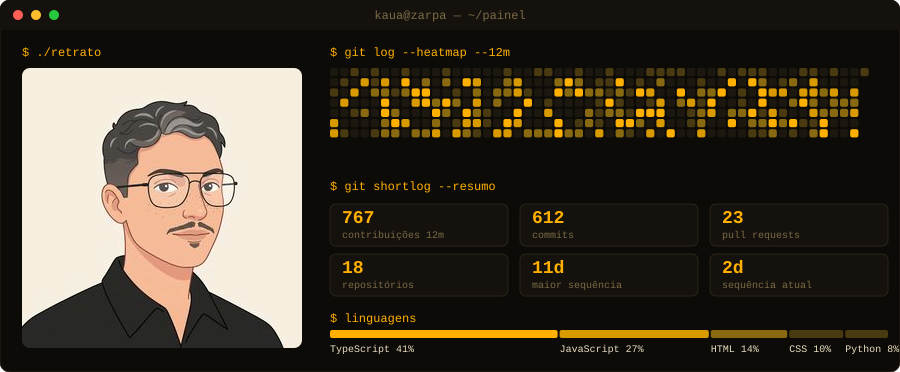

<p align="center">
  
</p>

<p align="center">
  
</p>

## `$ cat sobre.md`

Eu sou o **Kauã**, fundador da **[Zarpa Desenvolvimento](https://zarpadev.com.br)**, no Espírito Santo, atendendo o Brasil inteiro.
Há anos resolvo problema com tecnologia. Trabalho com comércio exterior, e foi lá que vi quanto tempo as empresas perdem com retrabalho.
Hoje construo **sites e sistemas sob medida** para negócios serem encontrados e escolhidos.

*Zarpar: partir, sair do cais. É isso que a marca faz com a ideia de quem chega até mim.*

## `$ ls projetos/`

| Projeto | O que é | Link |
|---|---|---|
| **Zarpa Dev** | Sites e sistemas sob medida | [zarpadev.com.br](https://zarpadev.com.br) |
| **Orçaí** | Orçamento por voz para autônomos e MEIs, com Pix e envio no WhatsApp | [orcaisoluti.vercel.app](https://orcaisoluti.vercel.app) |
| **Zarpa Delivery** | Cardápio digital: o cliente monta o pedido e ele chega pronto no WhatsApp | [zarpadelivery.vercel.app](https://zarpadelivery.vercel.app) |
| **Vitrine TV** | TV corporativa com a marca do cliente, controlada por painel | [zarpadev.com.br/vitrine-tv](https://zarpadev.com.br/vitrine-tv) |

## `$ stack --list`

```
front   ▸ HTML · CSS · JavaScript · TypeScript · React · Three.js
back    ▸ Supabase · Postgres · APIs · Automação
deploy  ▸ Vercel · Cloudflare
método  ▸ entender → pensar → construir → lançar
```

<details>
<summary>English</summary>

I'm **Kauã**, founder of **[Zarpa Dev](https://zarpadev.com.br)** (Espírito Santo, Brazil). Foreign trade background, now building custom websites and systems so businesses get found and chosen.

</details>

## `$ contato --abrir`

<p>
  <a href="https://wa.me/5527998690302?text=Quero%20tirar%20minha%20ideia%20do%20papel!"></a>
  <a href="https://instagram.com/pessinkauaa"></a>
  <a href="https://instagram.com/zarpa.dev"></a>
  <a href="https://zarpadev.com.br"></a>
</p>

<p align="center"><sub>Feito com café e <a href="https://zarpadev.com.br">Zarpa Dev</a></sub></p>
