<picture>
  <source media="(prefers-color-scheme: light)" srcset="assets/header-light.svg">
  
</picture>

<picture>
  <source media="(prefers-color-scheme: light)" srcset="assets/painel-light.svg">
  
</picture>

 

Venho do comércio exterior, onde tudo tem medida: prazo, peso, custo. Foi lá que aprendi a enxergar o retrabalho que ninguém vê.

Hoje, na **[Zarpa](https://zarpadev.com.br)**, eu desenho e construo sites e sistemas sob medida. Nada sai de prateleira: cada projeto nasce do problema de quem me procura, e quem desenha é quem constrói.

 

<table>
  <tr><td><code>01</code></td><td><b><a href="https://zarpadev.com.br">Zarpa Dev</a></b></td><td>Sites e sistemas sob medida, do primeiro traço ao ar.</td></tr>
  <tr><td><code>02</code></td><td><b><a href="https://orcaisoluti.vercel.app">Orçaí</a></b></td><td>Orçamento por voz para autônomos, com Pix e envio no WhatsApp.</td></tr>
  <tr><td><code>03</code></td><td><b><a href="https://zarpadelivery.vercel.app">Zarpa Delivery</a></b></td><td>Cardápio digital: o pedido chega pronto no WhatsApp.</td></tr>
  <tr><td><code>04</code></td><td><b><a href="https://zarpadev.com.br/vitrine-tv">Vitrine TV</a></b></td><td>A TV da empresa com a marca dela, controlada por um painel.</td></tr>
</table>

 

  
  
  <a href="https://zarpadev.com.br"><picture><source media="(prefers-color-scheme: light)" srcset="assets/btn-site-light.svg"></picture></a>
  <a href="https://instagram.com/zarpa.dev"><picture><source media="(prefers-color-scheme: light)" srcset="assets/btn-zarpa-light.svg"></picture></a>

English

 

I come from foreign trade, where everything has a measure: deadlines, weight, cost. Now, at **[Zarpa](https://zarpadev.com.br)**, I design and build custom websites and systems. The one who draws is the one who builds.

Desenhado e construído pela <a href="https://zarpadev.com.br">Zarpa Dev</a>

